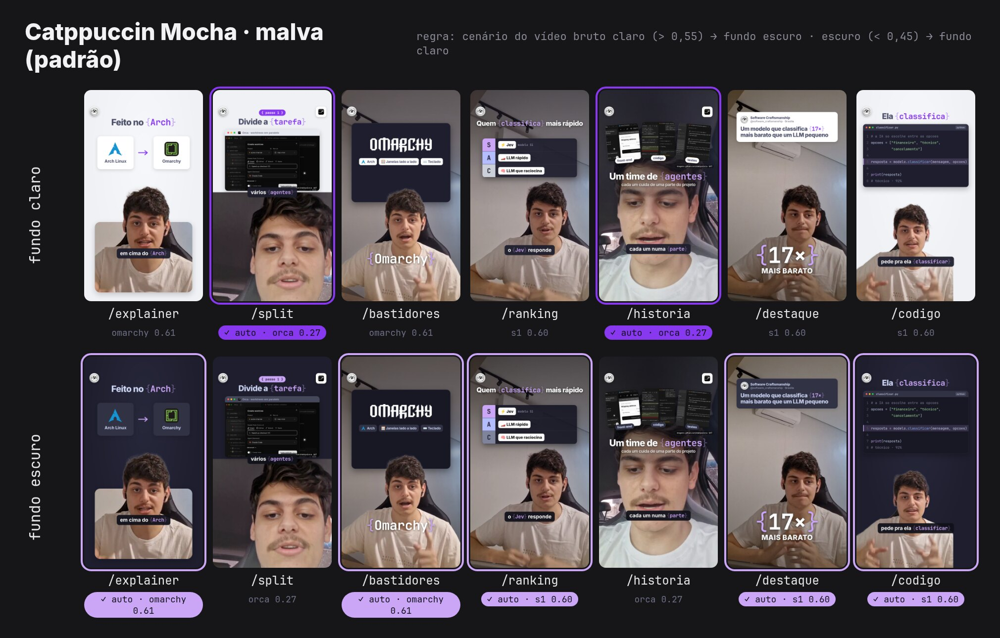

# craft-reels

Pipeline fixa de reels da **Software Craftsmanship Brasília**
([@software_craftsmanship](https://www.instagram.com/software_craftsmanship/)), feita para ser usada por
agentes de IA (Claude Code, Codex, Cursor…). Um vídeo falado de celular entra; sai um reel 1080x1920 de
**até 60 s**, com a identidade da comunidade, sempre pelas mesmas etapas.



## O que ele faz

- **Corta** gaguejo, "ééé", silêncio e toda frase que a pessoa marcou com "refaz"/"refaça"; confere cada
  trecho sozinho para não sobrar lasca nem fala repetida. Com o roteiro, escolhe a tomada certa.
- **Limpa o áudio** e deixa no volume do Instagram (-14 LUFS).
- **Legenda** em pílula, sempre embaixo e nunca sobre o rosto, com as palavras-chave em `{destaque}`.
- **Ilustra** cada ponto com um visual simples (lista, fluxo, comparação, contador, código, terminal, logo, print).
- **Mostra a logo** de todo produto ou empresa pública citado.
- **Cabe em 60 s**: se passar, acelera até 1,25x sem mudar o tom da voz.
- **Divulga só a comunidade**: selo e `@software_craftsmanship`, nunca a ferramenta.

Tudo roda na sua máquina, sem chave de API.

## Instalar

Precisa de Linux ou macOS com `ffmpeg` (com libvpx-vp9), Node.js 22+, Python 3.10+ e
[uv](https://docs.astral.sh/uv/).

```bash
git clone https://github.com/pedruck/craft-reels.git
cd craft-reels && ./install.sh
```

O `install.sh` liga as skills `/reel` e `/roteiro` em `~/.claude/skills` e prepara o kit de render. A
primeira transcrição baixa o Whisper large-v3 (~3 GB).

Como plugin do Claude Code:

```
/plugin marketplace add pedruck/craft-reels
/plugin install craft-reels@craft-reels
```

## Usar

Peça ao agente: *"faz o reel desse vídeo: ~/Downloads/video.mp4"*. Ou direto:

```bash
./craft run ~/Downloads/video.mp4 --nomes "Orca, Claude Code"
```

Ele roda até precisar do agente (escrever as cenas), e `./craft run <pasta>` continua. Para roteirizar
antes de gravar: *"/roteiro um vídeo de 50 s sobre X"*, e depois `--roteiro roteiro.md`.

Por padrão é tudo automático. Aprovar cortes, ver as cenas antes, trocar template, paleta ou fundo e
passar de 60 s são opções que o agente só usa se você pedir. Agentes: leiam o [`AGENTS.md`](AGENTS.md).

## Templates

| Template | Base no original | Para |
|---|---|---|
| `explainer` (padrão) | explainer | explicar um conceito |
| `split` | split-screen | mostrar uma ferramenta ou um passo a passo |
| `bastidores` | behind-the-person | apresentar um produto ou ideia de impacto |
| `ranking` | ranking-list | comparar opções |
| `historia` | storytelling | contar algo em partes |
| `destaque` | trial-reels | um dado ou frase de impacto |
| `codigo` | — (novo) | código, refatoração, terminal |

Paletas: **Catppuccin Mocha** (padrão), Catppuccin Latte e Nord, cada uma com fundo claro e escuro. O fundo
é escolhido pela luminosidade do vídeo: cenário claro pede fundo escuro, e vice-versa.

## Como é feito

```
craft                     a CLI (pipeline/cli.py): etapas 1–10, estado.json, saída OK/AVISO/ERRO
pipeline/                 cada etapa: preparar, transcrever, cortes, áudio, legenda, montar, duração, conferir, entregar
templates/motor.py        tema, selo, logos, visuais, legenda, validação — comum a todos
templates/<nome>/         build.py (layout), schema.json (formato do cenas.json), referência do original
kit/                      motor de render do claude-editing-skills (HyperFrames + GSAP + recorte)
tema/                     paletas.json e a logo da comunidade
catalogo/                 logos de produto e correções do Whisper
skills/                   /reel e /roteiro
docs/                     plano, armadilhas, prévias
testes/                   regras de corte, roteiro, legenda e validação
```

## Créditos

- **[Artem Novitckii](https://novitckii.com)** — [claude-editing-skills](https://github.com/artemnovitckii/claude-editing-skills)
  (MIT), a base deste projeto: o motor de render, a ideia de ancorar cada visual na palavra falada e os seis
  formatos que viraram templates aqui. O histórico original está preservado.
- **[HyperFrames](https://github.com/heygen-com/hyperframes)** (HeyGen, Apache-2.0) — render HTML → vídeo.
- **[GSAP](https://gsap.com)** (GreenSock) — animações.
- **[RobustVideoMatting](https://github.com/PeterL1n/RobustVideoMatting)** (Shanchuan Lin et al., GPL-3.0) —
  recorte da pessoa; o modelo é baixado na instalação.
- **[faster-whisper](https://github.com/SYSTRAN/faster-whisper)** (SYSTRAN, MIT) e
  **[Whisper](https://github.com/openai/whisper)** (OpenAI, MIT) — transcrição local.
- **[OpenCV](https://opencv.org)** (Apache-2.0) — detecção de rosto; **[FFmpeg](https://ffmpeg.org)** — tudo de
  vídeo e áudio; **[uv](https://github.com/astral-sh/uv)** (Astral) — ambientes dos scripts.
- **[Catppuccin](https://github.com/catppuccin/catppuccin)** e **[Nord](https://www.nordtheme.com)** (MIT) — paletas.
- **Fontes** (SIL OFL 1.1): [Inter](https://rsms.me/inter/), [JetBrains Mono](https://github.com/JetBrains/JetBrainsMono),
  e as do kit original (Archivo Black, DM Serif Display, Instrument Serif, Pixelify Sans, TikTok Sans).
- **[Simple Icons](https://simpleicons.org)** (CC0) — logos de produto; as marcas são de seus donos.
- **[Orca](https://github.com/stablyai/orca)** (MIT) — capturas usadas nas prévias e a logo do catálogo.
- **[Potrace](https://potrace.sourceforge.net)** (Peter Selinger) — vetorização da logo da comunidade.
- Ideias de [video-use](https://github.com/browser-use/video-use), [video-editing-skill](https://github.com/social-media-skills/video-editing-skill),
  [ghost-editor](https://github.com/kurbaitaev/ghost-editor) e [open-edits](https://github.com/kevinbadi/open-edits) (todos MIT).
- **Software Craftsmanship Brasília** — identidade visual e logo (da comunidade, fora da licença MIT).

Detalhes de licença em [`NOTICE.md`](NOTICE.md). Código sob [MIT](LICENSE).
